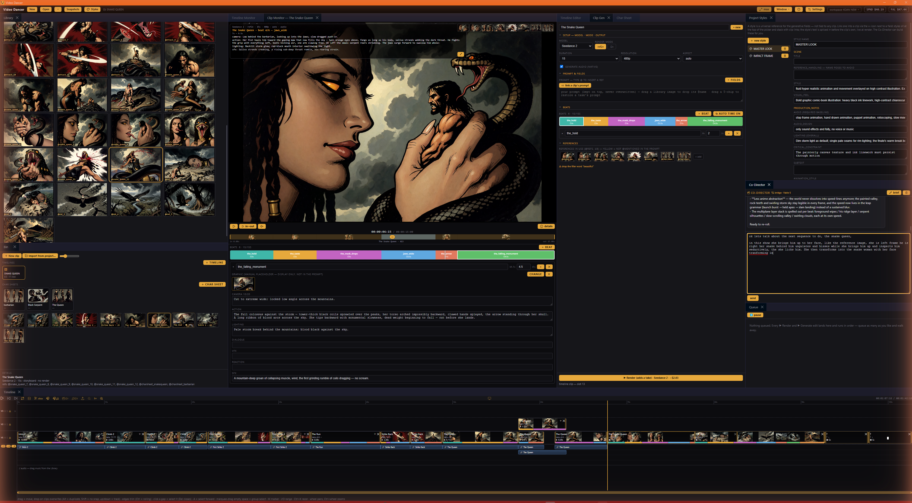
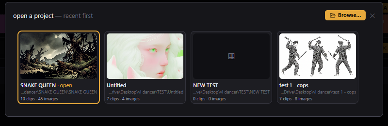
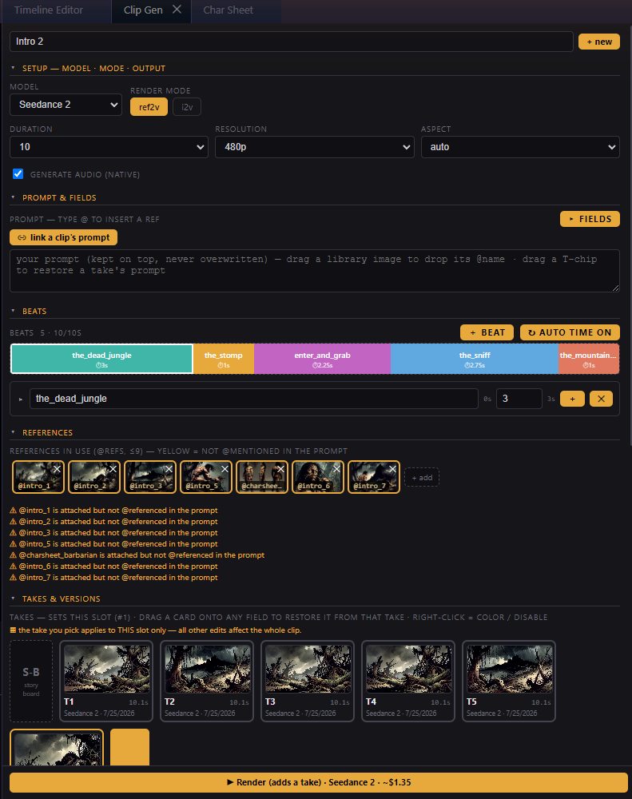
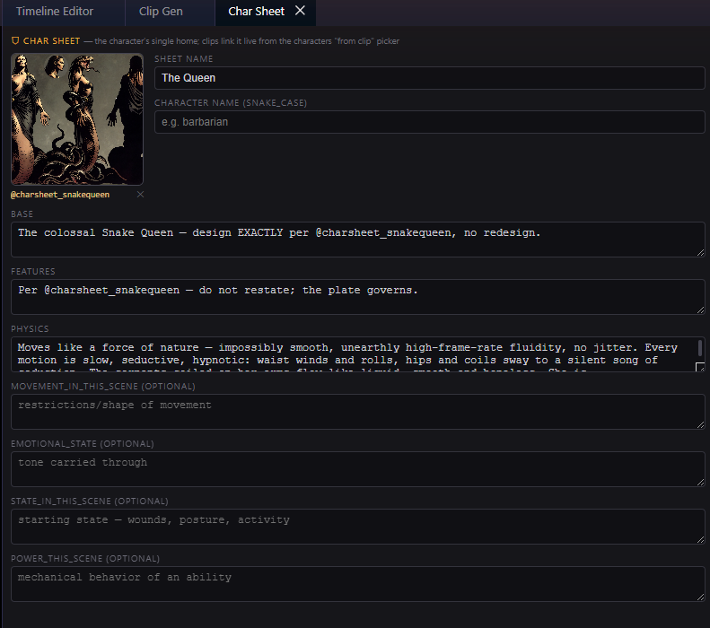
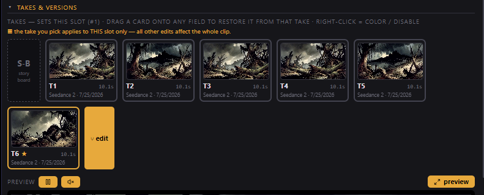
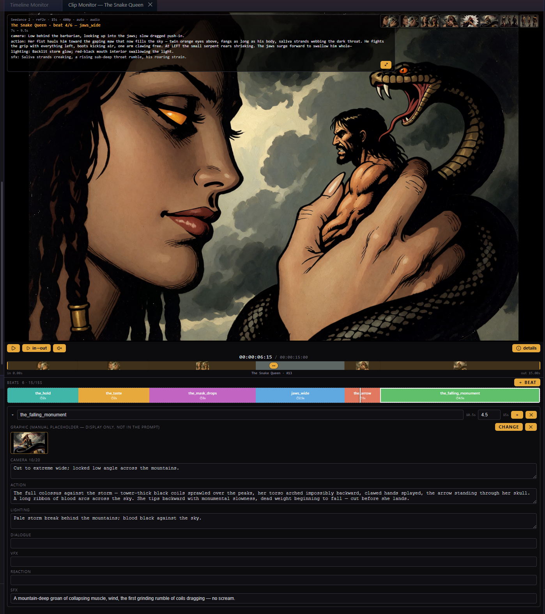
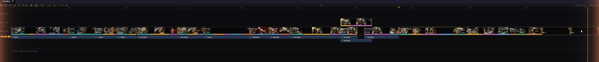
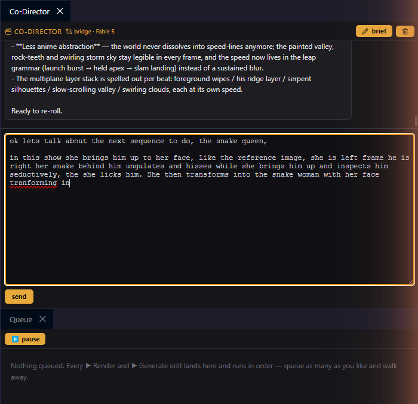

# Video Dancer

<p align="center">
  <a href="https://github.com/koan-shdw/video-dancer/releases/latest/download/VideoDancer-Windows-Setup.exe">
    <picture>
      <source media="(prefers-color-scheme: dark)" srcset=".github/buttons/download-windows-dark.svg">
      
    </picture>
  </a>
  &nbsp;&nbsp;
  <a href="https://github.com/koan-shdw/video-dancer/releases/latest/download/VideoDancer-Mac.dmg">
    <picture>
      <source media="(prefers-color-scheme: dark)" srcset=".github/buttons/download-mac-dark.svg">
      
    </picture>
  </a>
</p>

A local-first desktop editor for AI-generated video, built **storyboard-first**: you write each
shot as a structured plan (beats, characters, references, including **your own footage and music
as references**), render takes on top of the plan, **several at once**, through your own
AI-supplier account (fal.ai, BytePlus ModelArk, Astria, or a Bridge LOGIN into Higgsfield,
Runway, Magnific or Pika that spends the account's subscription credits), edit results non-destructively with
plain words (vid2vid), and cut everything on a Premiere-style multi-track timeline with music,
dissolves and mp4 export. Your projects, renders, and API keys stay on your machine, and they move
between projects when you want them to.



---

## For beta testers

### 1. Install

Download the installer for your platform from the latest [Release](../../releases) and run it.

**Windows**: `Video Dancer Setup x.y.z.exe`. Windows SmartScreen will warn ("Windows protected your
PC") because the app isn't code-signed yet. Click **More info → Run anyway**. (One-time.)

**macOS**: `Video Dancer-x.y.z.dmg`. The app isn't notarized yet, so Gatekeeper blocks it on first
launch. Either:
- **Right-click the app → Open**, then click **Open** in the dialog, **or**
- open it once, then go to **System Settings → Privacy & Security** and click **Open Anyway**.

(One-time per machine. Both warnings are expected for an unsigned beta; nothing is wrong.)

### 2. Connect a supplier (required for cloud engines)

Cloud rendering runs on **your own** account at an AI supplier. You pay them directly for what
you generate. There is no shared/bundled key. **Local LTX 2.5 needs no key at all**: it renders
free on your own NVIDIA GPU — the Models card installs the runtime, the engine and your pick of
sizes (quality int8 … minimum Q2, plus full dev bf16), each installed size its own entry in the
model dropdown, real step progress in the Queue. Its loras section is a live shelf: browse
Civitai, install official Lightricks adapters, drop in your own files — picked in Clip Gen with
per-lora strength and tap-in trigger chips. The first launch walks you through the supplier
options with paste-and-test boxes; four suppliers are supported:

- **[fal.ai](https://fal.ai) (recommended).** One key powers everything: Seedance 2 (with video/audio
  references), Seedance 2.5 (early access), Sora 2, Omni video edits, and image generation.
  Pay-per-use in dollars. Key at fal.ai → **Settings → Keys** (`id:secret`).
- **BytePlus ModelArk**: Seedance 2 **direct from ByteDance** (image + audio refs, 10-bit 4K).
  Their policy: reference images must not contain real human faces. Footage of real people stays a
  fal job. Token billing via [console.byteplus.com](https://console.byteplus.com/ark).
- **Astria**: Seedance 2 rendered against your Astria plan credits. t2v and first/last-frame
  i2v (no reference arrays over their API). Key at [astria.ai](https://www.astria.ai) →
  account → API.
- **Higgsfield (key)**: their developer API doesn't serve Seedance yet; use the Bridge login
  below instead. The key engine lights up here the day their API ships it.

**The Bridge panel** adds supplier LOGINS on top of keys: sign into Higgsfield, Runway, Magnific
or Pika on their own sites and renders spend those accounts' subscription credits. Every login
adds its Seedance rows to the model dropdown (MODEL picks the model, VIA picks who runs it), and
**Bridge (auto)** spends from the logged-in account holding the most credit. The panel shows each
account's credit, one stacked pool bar, and estimated render minutes.

**⚙ Settings → API suppliers** shows each one with a connected chip and a free **test key** button.
(Optional) a fal **admin** key shows your live $ balance in the header; connected ModelArk/Higgsfield
get their own console-link chips, and the **SPND** chip tracks what this project has spent.

A banner reminds you until at least one key is saved. **Costs are yours**: each cloud render
bills your supplier account at their rates. Local LTX renders bill nobody.

### 3. First steps

The first launch walks you through the API setup and a short tour of the panels (replay both
anytime from **About**).

- **New** project (top-left) → pick a folder. Everything for the project lives there. **Open**
  shows your recent projects as a grid. Click one to jump back in, **right-click one** for the
  standard suite: rename, duplicate, reveal in Explorer, remove from the list, or delete (to the
  Recycle Bin, never a hard delete):

  

- **Library**: import reference images, music, **and videos** (buttons or drag files in). Imported
  videos are normalized to a friendly H.264 once if needed, hover-scrub like takes, and carry plain
  titles. Right-click a video: **edit with AI** (the Video Editor tree), **make clip** (the footage
  becomes take 1 of a new clip), **add as take** to an existing clip, or just drag it onto the
  timeline and the clip is made for you. **watch folder** points at any external folder (Comfy
  outputs, downloads); it opens as its own **Watched** panel with the newest images live, and
  dragging one into the Library imports it. Right-click images to make clips from them, select
  several and drag them anywhere, including straight onto the timeline.
- **Bin**: **+ clip** → write the storyboard in **Clip Gen** → **▶ Render** (a "take").
- Drag clips onto the **Timeline**; trim, slice, stack tracks, add music; **⬆ Export** to mp4.
- **Snapshots** (💾): save a named state of the whole project and come back to it later. The
  working copy stays where you are.
- Press **?** anytime for the full shortcut + gesture cheat-sheet. Every gesture below is on it.

### 4. Write clips as storyboards (Clip Gen)

A clip isn't a prompt string. It's a plan. Scene fields, characters, and **beats**: the shot-by-shot
storyboard (camera / action / lighting / sfx, each with its own length) that becomes the
`cinematic_storyboard` the model receives. The colored beat bar is the movie; you'll see the same
colors again on every timeline block.



- **Beats**: drag boundaries to retime, **＋ beat** to add, right-click to delete, double-click to
  edit fields. Each beat can carry a **reference graphic**: a placeholder image the model receives
  as a general ref without polluting the prompt text.
- **References**: @-mention Library images in any field, or attach them as refs. The **S-B** slot
  marks which ref is the storyboard face for the clip.
- **Video & audio references** (Seedance): attach up to 3 videos (Library footage or any take)
  as `@video1…` slots and up to 3 music windows as `@audio1…`, then direct them in the prompt:
  *"Continue from @video1"*, *"Cut the motion to @audio1"*. Each slot has a ✂ window (the supplier
  caps refs at 15s combined) and warns yellow until it's @mentioned. Restyle your own footage,
  chain shots, motion-match a dance clip, sync to a beat. The loop that makes this app what it is.
- **Character links**: any character field can live-link to another clip's character, or to a
  **char sheet**, a standalone image + description that defines a character once for the whole
  project:

  

- **Take over a linked field**: normally your text is added after the linked text. Double-click
  any link chip and its text drops into the field for editing; the field now **replaces** the
  link. Click the faded chip to link back up (the field clears). On scene/production chips,
  right-click opens the source style or clip.
- **Styles**: project-wide style blocks (look, production notes, lighting…) pinned into every
  prompt from the **Project Styles** panel.
- **Find in the preview**: the generated-from-fields box under your prompt is selectable, and
  **Ctrl+F** while the mouse is over it opens a small find bar (match count, prev/next, Enter,
  Esc).

### 5. Takes

Every render lands as a **take**: an immutable video plus the exact recipe (beats/refs/settings)
frozen at render time.



- Click a card = keeper ★ (or, when you're editing a timeline slot, sets that slot's take).
- **Right-click a card** = color-highlight it, **disable** it as a dud (dimmed everywhere, skipped
  by the automatic keeper fallback), **delete** it (always warns first: pinned timeline shots leave
  with it, dynamic shots hop to the keeper, the file stays on disk, Ctrl+Z undoes), or send it to
  AI editing (v2v).
- **Drag a card onto any field** to restore that field from the take's frozen recipe, or drag it
  to the Bin to fork a whole new clip from that recipe.
- **S-B** is always the first card: the live storyboard, one click away from any take.

### 6. The Clip Monitor

Double-click a clip (Bin or timeline block) and it opens in the **Clip Monitor**: scrub it, switch
takes from the dropdown (S-B included), see the beat bar with the live beat readout, and grab
**⊢ first / last ⊣** frames straight into the Library.



### 7. The timeline

Premiere-grade editing on top of the storyboard model: every block wears its clip's beat colors,
and a block with no renders yet plays as its storyboard.



- **Tracks**: multiple video tracks (+V adds, ✕ deletes empty ones), per-track mute / solo / lock.
  Gaps are allowed; the topmost track wins.
- **Dynamic vs pinned blocks**: drag a CLIP down and its block follows the ★ keeper (dotted amber
  ring + ★ on the take label; picking takes in Clip Gen swaps the shot live). Drag a TAKE down and
  the block pins to it for good, named `KATA - take 3`. The block's take picker (label ▾) pins any
  block after the fact.
- **Audio always visible**: linked clip audio rides its block (blue, on the lane matching its video
  track). Right-click to unlink it onto a lane as a free green block with its own trims, gain and
  fades. Plus dedicated music lanes.
- **Smooth playback**: double-buffered player preloads every cut; what you scrub is what exports.
- **Editing**: free drag with snapping (**Shift = hold time**, track changes only; **S** toggles
  all snapping), **dropping on clips overwrites them Premiere-style** (split / trim / vanish),
  Alt-drag duplicates, marquee group select, **A** = select-forward tool, click a gap to select
  it and **Del** ripple-closes it, ripple delete on blocks, rolling trims (Ctrl on a flush
  edge), **C** slice tool / **Ctrl+K** razor at the playhead, **Q/W** ripple-to-playhead,
  per-block **speed** (0.25–4×), **0.5s cross-dissolves**, **⟲ loop** (right-click a block: a
  faded tail of repeats fills to the next block; drag the tail's end grip to set it),
  copy/paste (**Ctrl+V** ripple-inserts at the playhead; right-click a track → **paste here**
  drops with no ripple), nudges with **,** / **.**, **J/K/L**, **M** markers, **I/O** in/out
  range (loops playback, windows the export), wheel pans / Ctrl+wheel zooms at the cursor,
  safe-area guides, and a full-height playhead.
- **⬆ Export** composites exactly what you see (tracks, gaps as black, dissolves, speed, audio
  lanes with gain/fades, music) to mp4. An in/out range exports just that window.

### 8. Co-Director

A conversational copilot that reads the whole project and writes into it (beats, fields, refs,
styles) with every change tinted until you accept it. @-mention Library images and it sees the
actual pictures. Type while it thinks; queue follow-ups.



Runs on your Anthropic API key by default; **Settings → experimental** can switch it to a
**Claude Code bridge** that drives your own installed Claude Code (subscription login) instead.
Its guide files (the prompting bibles it follows) are editable per-user with load toggles.

### 9. Edit a video with words (v2v)

Made something that's *almost* right? Don't re-roll. Edit it. **One editor**: **⑂** on any take
(or right-click a Library video → **⑂ edit v2v**) opens it in the **Video Editor**: an
Image-Editor-style **results tree**, with your in/out window riding in. Slide the window to the
part you want changed (up to 10s at a time), type the change (*"Remove the ball. Keep everything
else the same."*) and generate. Every result lands as a node; select any node and generate again
to branch from it, hover-scrub everything, and *nothing touches the Bin until you keep something*.
The composer has two modes:

- **EDIT (Omni)**: frame-true, prompt + window only. Runs on **Gemini Omni Flash** (words only,
  always 720p/16:9/24fps out, ~$0.14/sec on your fal key).
- **RE-GEN (Seedance)**: your source rides as `@video1` with the full reference suite around it:
  image refs, extra videos, audio windows, output duration/resolution/aspect (4K on 2.5).

Keep a result by **dragging its node out**: onto a clip card (a new take on that clip) or empty
Bin space (a brand-new clip). Or bake it to **Library videos**, where it can turn around and
become the `@video1` reference for the next generation. Library-video sources can also wear a
**◉ primary** node: every ref using that video follows it, revert any time.

### 10. Rendering: now, or in line

Every render surface has two buttons. **▶ Render now** fires the job instantly (several can run
at once) and **＋ Queue** lines it up the classic way: one at a time, in order.

- Concurrency is capped **per provider** (ModelArk allows 3 at a time; fal queues extras on their
  own servers). An instant job the provider refuses as busy drops itself back into the queue once,
  with a toast; real errors still fail loud.
- The **Queue** panel shows every running job with its own live status and ETA (the header reads
  **N running · M waiting**), and **▶** on any waiting job promotes it to run immediately.
- **↑↓** reorder what's waiting, **⏸ pause** holds the queue lane (running and instant jobs always
  finish), **✕** cancels. Pending jobs are free to kill; a running job is already billing, so
  cancelling it is best-effort.
- Results drop into the Bin in order, whether or not you're watching. If the app dies mid-render,
  the finished video is **rescued on the next launch**; fal renders you paid for are not lost.

### 11. Make it yours

- **Themes** (⚙ Settings): OG VDancer, DECK (neon green), WINTERMUTE (steel blue), FUCKUP (70s
  burnt orange). Or **customize colors** live and save your own.
- **Workspaces** (header dropdown): save and switch whole panel layouts.
- **Window ▾**: every panel listed, closed ones reopen from here. **🖥** on the timeline mirrors
  playback fullscreen to a second display.
- **Image Editor**: double-click any Library image: variants tree, AI edits, a **✏ draw layer**
  (pen marks guide the model, sent only while visible), and grow-canvas resizing.

### 12. Getting clips out

- **⬆ Export** on the Timeline renders the sequence to mp4 (honors the I/O range).
- One clip? **Right-click it in the Bin → export video…**, or just **alt-drag** it onto your desktop
  or any folder. The file copies out, the original stays in the project.
- **Send to project**: right-click clips, images, music, char sheets or a whole timeline →
  **send to project** → pick a recent project or browse. Copies land there in a folder named after
  this project; a timeline brings every clip, take, ref and track it uses. The open project is
  never touched, and the receipt toast lists anything skipped.

### Hit a bug?

**About** (click the "Video Dancer" logo) → **open the log folder**, and send `main.log`. It records
errors, crashes, and what the app was doing.

### Known beta limitations

- Unsigned installers (the warnings above).
- **Seedance 2.5** appears in the engine picker but fal gates it behind early access. Request it on
  fal's model page; renders 403 until they approve. Its prices are provisional until fal publishes a
  rate card.
- **ModelArk**: video references aren't wired yet (their API wants public URLs; the slots say so),
  and remember their no-real-faces reference policy.
- **Higgsfield** connects but has no Seedance engine yet (waiting on their API).
- Windows auto-updates silently (checks on launch + every 3h; applies on restart). macOS is unsigned, so Mac testers grab each new build from Releases manually.
- Exported cross-dissolves render as a quick fade-dip; the in-app monitor previews the true
  crossfade. (A real ffmpeg xfade is on the list.)
- **J** jumps back 5s rather than true reverse shuttle.
- v2v edits always come back 720p / 16:9 / 24fps (the model's fixed output), so editing a 1080p or
  vertical clip means a downscale/reframe. Sources longer than 10s are windowed, not sent whole.
- Jobs still *waiting* in the Queue don't survive an app restart (a render already sent to fal is
  rescued).

---

## For developers

Electron 31 + React + TypeScript (electron-vite). Video export uses bundled
[FFmpeg](https://ffmpeg.org) (GPL) via [`ffmpeg-static`](https://github.com/eugeneware/ffmpeg-static);
see the in-app **About** box for attribution. `docs/WORKFLOW.md` is the meaning-level map of the
app. Read it before touching UX.

```bash
npm install
npm run dev          # launch the app in dev
npm run typecheck    # tsc --noEmit
npm run build        # bundle main/preload/renderer (electron-vite)
npm run dist:win     # package a Windows installer  → dist/
npm run dist:mac     # package a macOS dmg (run on macOS) → dist/
```

Releases are built by GitHub Actions on a version tag (see `.github/workflows/release.yml`):

```bash
npm version patch             # bumps package.json + creates a git tag
git push --follow-tags        # the tag triggers the Win + macOS build → public Release on koan-shdw/video-dancer
```

API keys are never stored in the repo or project folders, only in Electron `userData/settings.json`
on the local machine, encrypted at rest with the OS keychain (safeStorage).
